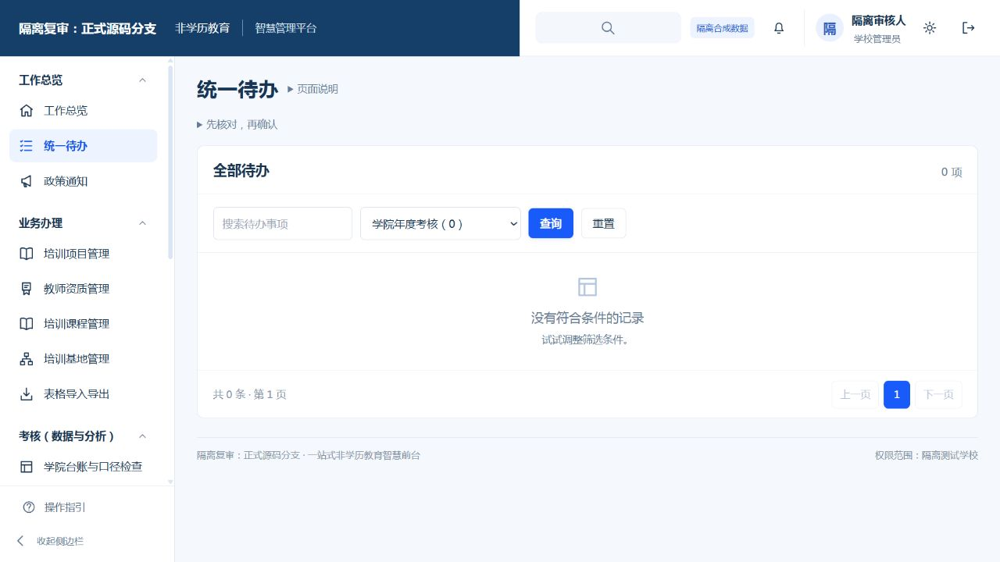
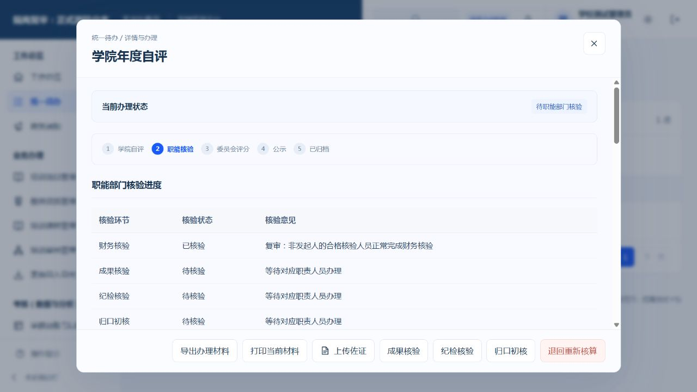

# 核心流程修复复审记录

本次以已提交源码 `88f67344` 为基线，纳入四角色走查、年度公示与积分更正、两条异常分支的局部修复。没有全量复制包含其他未提交变更的运行目录。

修复后，更正保存直接进入对应详情；已完成核验或须本人回避的事项不再留在待办；来源变化后的旧公示保留快照、标记替代、停止关联通知，新公示重新计满期限。台账姓名、时间、通知范围及认定状态显示同步修正。

## 独立复审结论

后端复审发现一处须修复问题：学校人员发起年度自评，同时拥有核验职责时，仍收到接口不允许办理的自审待办。已修复待办筛选，保留本人草稿和退回补正入口，后续核验、委员会评分及公示职责待办排除发起人。修复前复现失败，修复后通过。

前端、导出、权限裁剪、旧公示替代事务、原认定保护和重复入账防护没有发现其余确定的阻断缺陷。

## 干净分支验证

- 后端相关回归100项通过，覆盖社会培训、积分核对、本人服务、年度待办、通知、台账与归档保护。
- 前端相关回归183项通过。
- 两项自动浏览器脚本通过。脚本显式选择必填学院、项目层级和场景，并在保存详情就绪后继续办理；原业务校验保留。
- 另在独立服务和合成数据库中以真实浏览器检查：本人草稿待办保留、提交及刷新后不再有自审待办、其他合格核验人接收待办并完成财务核验。
- 源码齐套检查和差异空白检查通过。

本人提交后不再收到自审待办：

其他核验人正常完成财务核验：

以上均为隔离合成验证。真实学校账号、正式校历、实际连续公示期限、真实接口联调、正式数据库与生产发布未在本次验收。

## 纳入范围

本次只移植走查差额和必要回归。其他窗口的人事调岗授权、认证来源迁移、接口联调、部署和打包变更保留在原工作区，不包含在本次提交中。源码基线的迁移头仍为 `20261009_0003`；本次不调整迁移链，也不构成生产部署放行。
